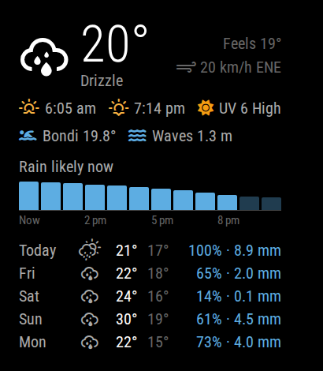

# MMM-AusWeather

A [MagicMirror²](https://magicmirror.builders/) module for Australian weather: current conditions, sunrise and sunset, UV, an hourly rain chart, a daily forecast, and the sea temperature at your closest beach.



## Features

- Current temperature, conditions, feels-like and wind
- Sunrise and sunset times
- Today's maximum UV, coloured using the Australian UV index categories
- Hourly chance of rain for the next 12 hours, with a summary such as "Rain likely from 3 pm"
- Daily forecast with highs, lows, chance of rain and expected rainfall
- Sea temperature and wave height at a beach you choose, or at the nearest open ocean if you don't choose one
- Times are shown in the forecast location's time zone

## Requirements

Data comes from [Open-Meteo](https://open-meteo.com/), which is free for non-commercial use and needs **no API key or sign-up**. The module makes two requests per update (forecast and sea), so the default 15-minute interval is about 200 requests a day.

The module has no npm dependencies and needs Node.js 18 or later.

## Installation

```bash
cd ~/MagicMirror/modules
git clone https://github.com/lachie-92/MMM-AusWeather.git
```

Then add the module to your config.

## Configuration

Add this to the `modules` array in `~/MagicMirror/config/config.js`:

```javascript
{
    module: "MMM-AusWeather",
    position: "top_right",
    header: "Sydney",
    config: {
        latitude: -33.87,
        longitude: 151.21,
        beach: {
            name: "Bondi",
            latitude: -33.893,
            longitude: 151.281
        }
    }
}
```

| Option | Default | Description |
| --- | --- | --- |
| `latitude` | `null` | **Required.** Latitude of your location. |
| `longitude` | `null` | **Required.** Longitude of your location. |
| `beach` | `null` | Beach for the sea temperature: `{ name, latitude, longitude }`. If not set, the nearest open ocean within 100 km is used (see [Sea temperature](#sea-temperature)). |
| `updateInterval` | `900000` | How often to refresh, in milliseconds (default 15 minutes). |
| `animationSpeed` | `1000` | Fade speed when the display updates, in milliseconds. |
| `forecastDays` | `5` | Days in the forecast, including today (up to 16). |
| `rainHours` | `12` | Hours shown in the rain chart. |
| `rainThreshold` | `50` | Chance of rain (%) at which rain counts as likely. Hours at or above it are highlighted in the chart. |
| `showFeelsLike` | `true` | Show the feels-like temperature. |
| `showWind` | `true` | Show wind speed and direction. |
| `showUV` | `true` | Show today's maximum UV index. |
| `showSea` | `true` | Show the sea temperature. |
| `showWaves` | `true` | Show wave height next to the sea temperature. |
| `showRainChart` | `true` | Show the hourly rain chart. |
| `showForecast` | `true` | Show the daily forecast. When it's hidden, today's chance of rain moves up next to sunrise and sunset. |
| `timeFormat` | Your MagicMirror² setting | `12` or `24` hour times. |

### Finding coordinates

In Google Maps, right-click a spot and click the coordinates at the top of the menu to copy them. On [OpenStreetMap](https://www.openstreetmap.org/), right-click and choose "Show address".

## Sea temperature

The sea temperature comes from Open-Meteo's [Marine API](https://open-meteo.com/en/docs/marine-weather-api). It's the forecast temperature of the nearest ocean grid square (about 8 km across), which is updated once a day. It's a good guide to the water at your beach, but it isn't a measurement taken at the shore.

- **With `beach` set**, the module uses the closest ocean grid square to those coordinates. If it reports that there's no sea data, move the point slightly offshore.
- **Without `beach`**, the module searches up to 100 km from your location when it starts and uses the closest open ocean it finds. Harbours and rivers are skipped. The MagicMirror² logs show the point it chose, for example `using sea point -33.79, 151.29 (27 km away)`.

## UV index

The UV shown is today's forecast maximum, using the Australian categories: Low (0–2), Moderate (3–5), High (6–7), Very high (8–10) and Extreme (11+).

## Updating

```bash
cd ~/MagicMirror/modules/MMM-AusWeather
git pull
```

## Customisation

Override any styles from `MMM-AusWeather.css` in `~/MagicMirror/config/custom.css`, so they survive updates. Every style is scoped under `.ausweather`.

## Troubleshooting

- **"Set latitude and longitude in the module config"**: add `latitude` and `longitude` to the module's `config` block.
- **"Sea temperature unavailable"**: check the MagicMirror² logs (e.g. `pm2 logs mm`) for the reason. If there's no ocean within 100 km, set `beach` coordinates. If your beach has no data, move its point slightly offshore.
- **"Update failed"**: the last good data stays on screen. The message shows why the latest update failed, usually a network problem.
- **Swimmer icon missing**: your MagicMirror² may bundle an older Font Awesome. Updating MagicMirror² should fix it.

## Data and attribution

Weather and marine data by [Open-Meteo.com](https://open-meteo.com/), licensed under [CC BY 4.0](https://creativecommons.org/licenses/by/4.0/). Weather icons by [Weather Icons](https://erikflowers.github.io/weather-icons/), bundled with MagicMirror².

## License

[MIT](LICENSE)
